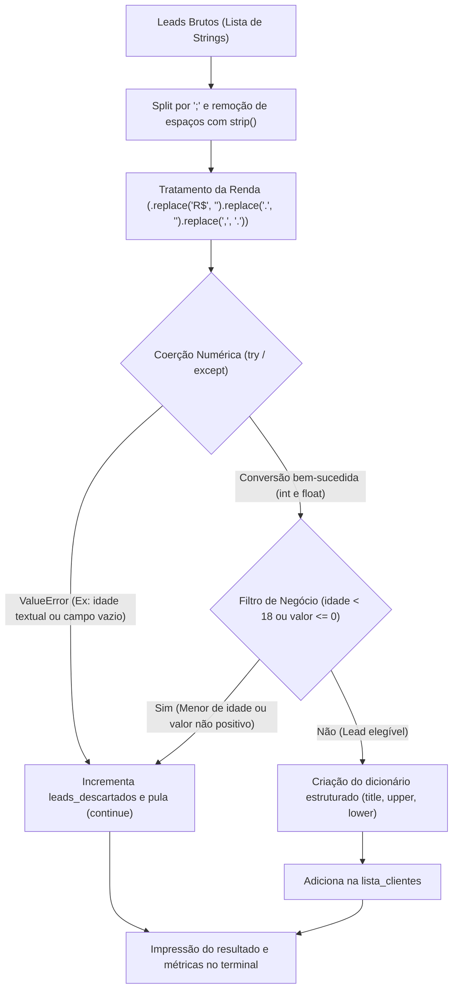
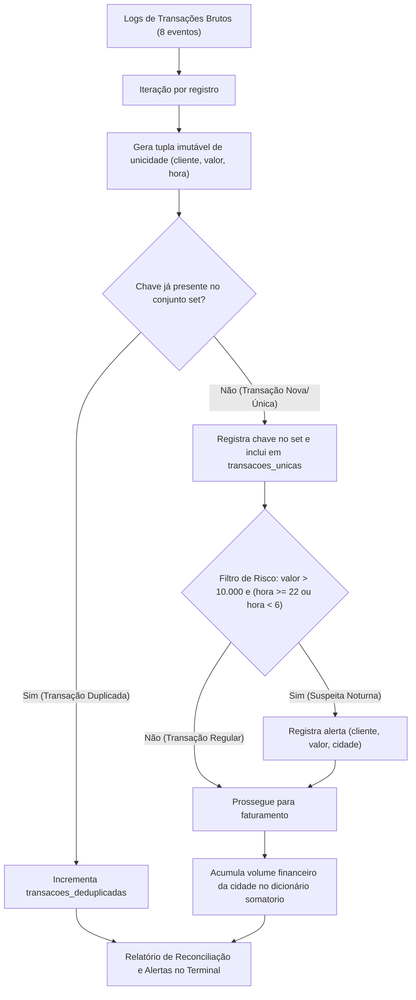
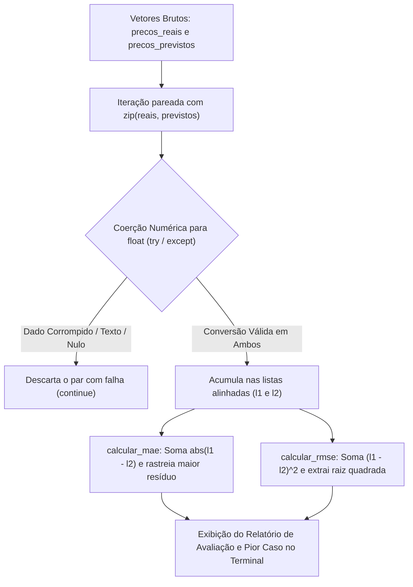
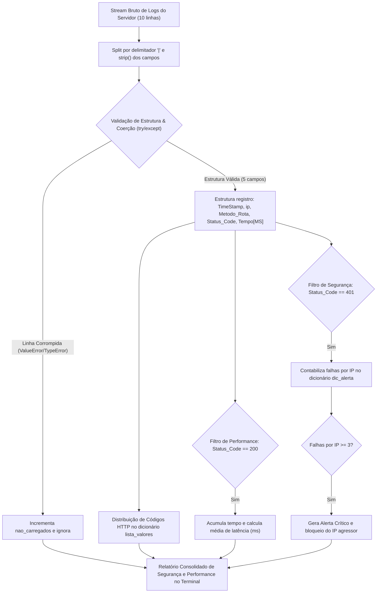

# 🥋 Python Pure Data Challenges: Pre-OOP Foundation Track

[](https://www.python.org/)
[](LICENSE)
[](https://peps.python.org/pep-0008/)

Trilha intensiva e progressiva de engenharia e análise de dados em **Python Puro** (*Pure Python* — sem Pandas, NumPy ou bibliotecas de terceiros), focada no desenvolvimento do raciocínio algorítmico, manipulação nativa de estruturas em memória, blindagem defensiva e análise de complexidade computacional ($O(1)$ vs $O(N)$) antes da transição para Programação Orientada a Objetos (POO).

---

## 1. Objetivo

Na formação de um Engenheiro de Machine Learning e Cientista de Dados, recorrer de imediato a abstrações prontas de alto nível (como Pandas e Scikit-Learn) sem o domínio da mecânica fundamental da linguagem oculta gargalos de performance, fragilidades no tratamento de exceções e a intuição matemática sobre as transformações de dados.

Este repositório consolida a conclusão dos **4 desafios práticos de mercado**, resolvidos exclusivamente com a biblioteca padrão do Python:

1. **Nível 1 (Sanitizador de Leads de Fintech):** Parsing defensivo de strings cadastrais corrompidas, coerção estrita de tipos com `try...except`, filtros de elegibilidade de crédito e estruturação em dicionários nativos.
2. **Nível 2 (Reconciliação Financeira & Anti-Fraude):** Deduplicação de transações em tempo constante ($O(1)$) através de tuplas compostas imutáveis e `set`, monitoramento em tempo real de anomalias noturnas de alto valor e agregação regional de faturamento.
3. **Nível 3 (Mini-Motor de Métricas de Machine Learning):** Alinhamento pareado de predições com `zip`, tratamento de inferências corrompidas e cálculo manual das métricas de regressão **MAE** (Mean Absolute Error) e **RMSE** (Root Mean Squared Error), identificando resíduos extremos.
4. **Nível 4 (Pipeline de Ingestão de Logs & Detecção de Força Bruta):** Ingestão e parsing de stream textual bruto de servidores web, auditoria de latência média de resposta (status 200), distribuição de códigos HTTP e algoritmo de detecção de ataques de força bruta (*Brute Force Attack*) por contagem de falhas consecutivas de autenticação (status 401).

---

## 2. Demonstração

### Pipeline Nível 1: Sanitizador de Leads (`desafio_01.py`)



#### Saída no Terminal:
```text
[{'id': 101, 'nome': 'Ana Silva', 'idade': 29, 'valor': 4500.0, 'estado': 'SP', 'situacao': 'aprovado'}, {'id': 104, 'nome': 'Daniel Alves', 'idade': 41, 'valor': 12000.0, 'estado': 'SP', 'situacao': 'aprovado'}, {'id': 108, 'nome': 'Roberto Carlos', 'idade': 65, 'valor': 25000.0, 'estado': 'SP', 'situacao': 'aprovado'}]
Quantidades de leads recebidos: 8
Quantidade de leads aprovados: 3
Quantidade de leads descartados 5
```

---

### Pipeline Nível 2: Reconciliação & Anti-Fraude (`desafio_02.py`)



#### Saída no Terminal:
```text
Transaçoes processadas: 6 | Transaçoes deduplicadas: 2
Lista de alertas de fraudes noturnos:
 [('Ryan', 12500.0, 'Goiânia'), ('Beatriz', 15000.0, 'Goiânia')]
Faturamento total consolidado por cidade:
{'Goiânia': 27950.0, 'São Paulo': 300.0, 'Brasília': 8000.0, 'Anápolis': 22000.0}
```

---

### Pipeline Nível 3: Mini-Motor de Métricas de ML (`desafio_03.py`)



#### Saída no Terminal:
```text
LISTAS LIMPAS:
[45000.0, 72000.0, 110000.0, 65000.0]
[43500.0, 75000.0, 102000.0, 64500.0]
Erro médio absoluto: R$ 3250.00
RMSE R$ 4344.54
Caso com maior erro individual: 
Valor Real: 110000.0
Vaslor Previsto: 102000.0
Diferença: 8000.0
```

---

### Pipeline Nível 4: Ingestor de Logs & Detecção de Força Bruta (`desafio_04.py`)



#### Saída no Terminal:
```text
============================================================
         RELATÓRIO DE SEGURANÇA E PERFORMANCE
============================================================
Total de logs processados   : 10
Logs válidos carregados     : 9
Logs corrompidos ignorados  : 1

--- DISTRIBUIÇÃO DE STATUS HTTP ---
  • Código 200 (Sucesso): 4 requisições
  • Código 401 (Não Autorizado): 4 requisições
  • Código 404 (Não Encontrado): 1 requisições

--- PERFORMANCE ---
  • Tempo médio de resposta (status 200): 176.25 ms

--- AUDITORIA DE SEGURANÇA (FORÇA BRUTA DETECTADA) ---
  [ALERTA] IP 192.168.1.15 bloqueado com 4 falhas de autenticacao!
============================================================
```

---

## 3. Tecnologias Utilizadas

- **Linguagem:** [Python 3.12](https://www.python.org/)
- **Estruturas de Dados Nativas & Complexidade:**
  - `set`: Busca e inserção em tempo constante médio ($O(1)$) via hashing para deduplicação instantânea.
  - `tuple`: Estrutura imutável e hashable utilizada como chave composta para unicidade `(cliente, valor, hora)`.
  - `dict`: Mapeamento estruturado de entidades, acumulador multidimensional de faturamento e tabela hash de contagem de frequência para segurança cibernética.
  - `list`: Coleções sequenciais ordenadas para acumulação dinâmica de registros íntegros.
- **Funções Built-in & Manipulação Vetorial:**
  - `zip()`: Pareamento simultâneo e sincronizado de vetores em memória sem indexação manual.
  - `abs()`, `len()`, operadores aritméticos de exponenciação (`** 2`) e radiciação (`** 0.5`).
- **Fundamentos Matemáticos e Estatísticos de Machine Learning:**
  - **Função de Perda L1 / MAE:** $\text{MAE} = \frac{1}{n} \sum_{i=1}^{n} |y_i - \hat{y}_i|$
  - **Função de Perda L2 / RMSE:** $\text{RMSE} = \sqrt{\frac{1}{n} \sum_{i=1}^{n} (y_i - \hat{y}_i)^2}$
  - Estatística descritiva de latência média e análise de sensibilidade a outliers.
- **Engenharia de Software e Padrões:**
  - Encapsulamento modular em funções procedimentais reutilizáveis (`def`).
  - Tratamento defensivo rigoroso com captura de exceções específicas: `try...except (ValueError, TypeError)`.
- **Versionamento:** [Git](https://git-scm.com/) e [GitHub](https://github.com/).

---

## 4. Estrutura do Projeto

```text
python-pure-data-challenges/
├── desafios/
│   ├── desafio_01.py        # Nível 1: Sanitizador Defensivo de Leads de Fintech
│   ├── desafio_02.py        # Nível 2: Reconciliação Financeira & Anti-Fraude Noturno
│   ├── desafio_03.py        # Nível 3: Mini-Motor de Métricas de Machine Learning (MAE e RMSE)
│   └── desafio_04.py        # Nível 4: Pipeline de Ingestão de Logs & Detecção de Força Bruta
├── .gitignore               # Configuração para ignorar arquivos temporários e caches
├── LICENSE                  # Licença MIT oficial do projeto
├── README.md                # Documentação técnica completa da trilha
└── ROADMAP.md               # Roteiro conceitual e especificações dos desafios
```

---

## 5. Como Executar

### Pré-requisitos
- Ter o **Python 3.10 ou superior** instalado na máquina.
- Git instalado (opcional, para clonar).

### Passo a Passo

1. **Clonar o Repositório:**
   ```bash
   git clone https://github.com/ryanaurelio2005/python-pure-data-challenges.git
   cd python-pure-data-challenges
   ```

2. **Executar o Desafio 01 (Sanitizador de Leads):**
   ```bash
   python .\desafios\desafio_01.py
   ```

3. **Executar o Desafio 02 (Reconciliação Financeira):**
   ```bash
   python .\desafios\desafio_02.py
   ```

4. **Executar o Desafio 03 (Métricas de Machine Learning):**
   ```bash
   python .\desafios\desafio_03.py
   ```

5. **Executar o Desafio 04 (Auditoria de Logs & Força Bruta):**
   ```bash
   python .\desafios\desafio_04.py
   ```

*Nota: Não é necessária a instalação de nenhuma biblioteca externa (`pip`), pois toda a trilha foi construída estritamente com os recursos nativos do Python.*

---

## 6. Datasets Utilizados

### Desafio 01: Lote Cadastral de Leads Brutos (Strings com Delimitador `;`)
```python
leads_brutos = [
    "  101 ; ANA SILVA ; 29 ; R$ 4.500,00 ; SP ; aprovado ",
    "102;CARLOS SOUZA;trinta e dois;R$ 8.900,50;RJ;aprovado",
    " 103 ; beatriz lima ; 24 ; ; MG ; reprovado ",
    "104; DANIEL ALVES ; 41 ; R$ 12.000,00 ; sp ; APROVADO",
    "105;EDUARDO RAMOS;17;R$ 1.500,00;BA;reprovado",
    " ; Marcos Castro ; 35 ; R$ 3.200,00 ; GO ; pendente ",
    "107; Fernanda Torres ; 52 ; R$ -500,00 ; PR ; aprovado ",
    "108; Roberto Carlos ; 65 ; R$ 25.000,00 ; SP ; aprovado ",
]
```

---

### Desafio 02: Logs de Transações do Gateway Financeiro (Dicionários)
```python
logs_transacoes = [
    {"id": "tx1", "cliente": "Ryan", "valor": 12500.0, "hora": 23, "cidade": "Goiânia"},
    {"id": "tx2", "cliente": "Lucas", "valor": 300.0, "hora": 14, "cidade": "São Paulo"},
    {"id": "tx3", "cliente": "Ryan", "valor": 12500.0, "hora": 23, "cidade": "Goiânia"},  # Duplicada de tx1
    {"id": "tx4", "cliente": "Carla", "valor": 8000.0, "hora": 9, "cidade": "Brasília"},
    {"id": "tx5", "cliente": "Lucas", "valor": 300.0, "hora": 14, "cidade": "São Paulo"},  # Duplicada de tx2
    {"id": "tx6", "cliente": "Beatriz", "valor": 15000.0, "hora": 2, "cidade": "Goiânia"},
    {"id": "tx7", "cliente": "Ryan", "valor": 450.0, "hora": 15, "cidade": "Goiânia"},
    {"id": "tx8", "cliente": "Marcos", "valor": 22000.0, "hora": 21, "cidade": "Anápolis"},
]
```

---

### Desafio 03: Logs de Inferência de Regressão (Pares Real vs Previsto)
```python
precos_reais = [45000.0, 72000.0, "corrompido", 110000.0, 28000.0, 65000.0, ""]
precos_previstos = [43500.0, 75000.0, 80000.0, 102000.0, "erro", 64500.0, 30000.0]
```

---

### Desafio 04: Stream Textual de Requisições de Servidor Web
```python
logs_servidor = [
    "2026-10-28 01:00:10 | 192.168.1.10 | GET /home | 200 | 120ms",
    "2026-10-28 01:00:12 | 192.168.1.15 | POST /login | 401 | 45ms",
    "2026-10-28 01:00:13 | 192.168.1.15 | POST /login | 401 | 50ms",
    "2026-10-28 01:00:14 | 192.168.1.15 | POST /login | 401 | 48ms",
    "2026-10-28 01:00:15 | 192.168.1.20 | GET /dashboard | 200 | 310ms",
    "linha_corrompida_sem_separadores",
    "2026-10-28 01:00:18 | 192.168.1.15 | POST /login | 401 | 40ms",
    "2026-10-28 01:00:20 | 192.168.1.25 | GET /produtos | 404 | 15ms",
    "2026-10-28 01:00:22 | 192.168.1.10 | GET /perfil | 200 | 180ms",
    "2026-10-28 01:00:25 | 192.168.1.15 | POST /login | 200 | 95ms",
]
```

---

## 7. Resultados Consolidados da Trilha

| Desafio | Dados Processados | Casos Válidos | Casos Rejeitados / Filtrados | Principais Métricas & Insights Gerados |
| :--- | :---: | :---: | :---: | :--- |
| **Nível 1 (Leads)** | 8 registros | 3 aprovados (37,5%) | 5 descartados (62,5%) | Normalização cadastral (Title Case, UF), descarte de menores e valores $\le 0$. |
| **Nível 2 (Finanças)** | 8 transações | 6 únicas mantidas | 2 duplicatas eliminadas | Deduplicação $O(1)$, 2 alertas noturnos de fraude e faturamento de R$ 27.950,00 em Goiânia. |
| **Nível 3 (Métricas ML)** | 7 pares | 4 pares íntegros | 3 pares corrompidos | **MAE:** R$ 3.250,00 \| **RMSE:** R$ 4.344,54 \| **Maior Resíduo:** R$ 8.000,00. |
| **Nível 4 (Auditoria Web)** | 10 logs | 9 logs carregados | 1 linha corrompida | **Latência Média (200):** 176.25 ms \| **Ataque Bloqueado:** IP `192.168.1.15` (4 falhas 401). |

---

## 8. Próximas Versões

Roadmap de evolução técnica após o domínio da base algorítmica:

- [x] **Nível 1:** Sanitizador Defensivo de Leads de Fintech (Concluído).
- [x] **Nível 2:** Reconciliação Financeira com Deduplicação (`set`) e Detecção de Fraude Noturna (Concluído).
- [x] **Nível 3:** Mini-Motor de Métricas de Machine Learning — MAE e RMSE (Concluído).
- [x] **Nível 4:** Ingestor de Stream de Logs, Auditoria de Latência e Detector de Força Bruta (Concluído).
- [ ] **Módulo POO (Programação Orientada a Objetos):** Refatoração da trilha convertendo os pipelines procedimentais em Classes modulares e testáveis de Engenharia de Dados (`LeadPipeline`, `FraudReconciler`, `RegressionMetricsEvaluator`, `LogSecurityAuditor`).

---

## 👨‍💻 Autor

Desenvolvido por **[Ryan Aurélio](https://github.com/ryanaurelio2005)**.  
*Estudante de Ciência de Dados e Inteligência Artificial (PUC Goiás) | Foco em Engenharia de Machine Learning.*
