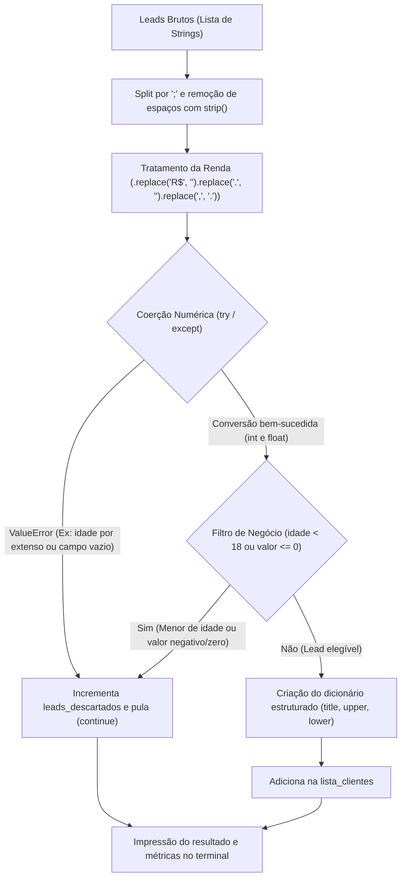

# 🥋 Python Pure Data Challenges: Pre-OOP Foundation Track

[](https://www.python.org/)
[](LICENSE)
[](https://peps.python.org/pep-0008/)

Série prática de desafios em **Python Puro** (*Pure Python* — sem Pandas ou NumPy), focada no desenvolvimento do raciocínio analítico, manipulação nativa de estruturas de dados e tratamento defensivo antes da transição para Programação Orientada a Objetos (POO).

---

## 1. Objetivo

Na preparação para atuar como Engenheiro de Machine Learning e Cientista de Dados, depender exclusivamente de bibliotecas prontas como Pandas sem dominar os fundamentos da linguagem cria lacunas severas de lógica, controle de exceções e performance.

Este repositório documenta a resolução prática de problemas reais de dados utilizando **estritamente os recursos nativos do Python**.

No **Desafio 01**, o objetivo é sanitizar dados cadastrais sujos de leads vindos de formulários de uma fintech, aplicando:
- **Sanitização de Strings:** Tratamento de delimitadores (`;`), eliminação de espaços residuais e formatação padronizada de strings (`.strip()`, `.split()`, `.replace()`, `.title()`, `.upper()`, `.lower()`).
- **Coerção de Tipos e Tratamento de Exceções:** Uso defensivo de `try...except ValueError` para blindar o fluxo contra valores não numéricos, textos corrompidos ou campos ausentes.
- **Regras de Negócio e Filtragem:** Descarte de registros inelegíveis (menores de idade e renda não positiva).
- **Estruturação em Dicionários:** Organização dos registros válidos em dicionários para alimentar futuros modelos ou esteiras de análise.

---

## 2. Demonstração

### Fluxo Lógico do Pipeline (`desafio_01.py`)



### Execução no Terminal

```text
[{'id': 101, 'nome': 'Ana Silva', 'idade': 29, 'valor': 4500.0, 'estado': 'SP', 'situacao': 'aprovado'}, {'id': 104, 'nome': 'Daniel Alves', 'idade': 41, 'valor': 12000.0, 'estado': 'SP', 'situacao': 'aprovado'}, {'id': 108, 'nome': 'Roberto Carlos', 'idade': 65, 'valor': 25000.0, 'estado': 'SP', 'situacao': 'aprovado'}]
Quantidades de leads recebidos: 8
Quantidade de leads aprovados: 3
Quantidade de leads descartados 5
```

---

## 3. Tecnologias Utilizadas

- **Linguagem:** [Python 3.12](https://www.python.org/)
- **Estruturas Nativas:**
  - `list`: Armazenamento ordenado e acumulação dos leads brutos e processados.
  - `dict`: Mapeamento chave-valor dos registros de clientes validados.
- **Manipulação de Texto e Tipos:**
  - Métodos nativos de string: `.split()`, `.strip()`, `.replace()`, `.title()`, `.upper()`, `.lower()`.
  - Coerções primitivas: `int()`, `float()`.
- **Controle de Fluxo e Resiliência:**
  - Laços de iteração `for`.
  - Tratamento defensivo de erros com bloco `try...except ValueError`.
  - Controle de iteração com `continue`.
- **Versionamento:** [Git](https://git-scm.com/) e [GitHub](https://github.com/).

---

## 4. Estrutura do Projeto

```text
python-pure-data-challenges/
├── desafios/
│   └── desafio_01.py        # Solução autoral do Desafio 01 (Sanitizador de Leads)
├── .gitignore               # Configuração para ignorar arquivos temporários e caches
├── README.md                # Documentação técnica completa do repositório
└── ROADMAP.md               # Guia com especificações e contexto dos próximos desafios
```

---

## 5. Como Executar

### Pré-requisitos
- Ter o **Python 3.10 ou superior** instalado na máquina.
- Git instalado (opcional, para clonar).

### Passo a Passo

1. **Clonar o Repositório:**
   ```bash
   git clone https://github.com/ryanaurelio2005/python-pure-data-challenges.git
   cd python-pure-data-challenges
   ```

2. **Executar o Desafio 01:**
   ```bash
   python .\desafios\desafio_01.py
   ```

*Nota: Não é necessária a instalação de nenhuma biblioteca externa (`pip`), pois todo o projeto foi construído utilizando apenas a biblioteca padrão do Python.*

---

## 6. Dataset

O conjunto de dados do **Desafio 01** simula entradas textuais brutas provenientes de formulários web de solicitação de crédito sem validação de front-end:

```python
leads_brutos = [
    "  101 ; ANA SILVA ; 29 ; R$ 4.500,00 ; SP ; aprovado ",
    "102;CARLOS SOUZA;trinta e dois;R$ 8.900,50;RJ;aprovado",
    " 103 ; beatriz lima ; 24 ; ; MG ; reprovado ",
    "104; DANIEL ALVES ; 41 ; R$ 12.000,00 ; sp ; APROVADO",
    "105;EDUARDO RAMOS;17;R$ 1.500,00;BA;reprovado",
    " ; Marcos Castro ; 35 ; R$ 3.200,00 ; GO ; pendente ",
    "107; Fernanda Torres ; 52 ; R$ -500,00 ; PR ; aprovado ",
    "108; Roberto Carlos ; 65 ; R$ 25.000,00 ; SP ; aprovado ",
]
```

### Dicionário de Campos e Regras de Validação

| Campo | Posição | Tipo Esperado | Regra de Sanitização / Negócio |
| :--- | :---: | :---: | :--- |
| `id` | 0 | `int` | Conversão para inteiro. Descartado se vazio ou inválido. |
| `nome` | 1 | `str` | Remoção de espaços nas bordas e formatação em Title Case. |
| `idade` | 2 | `int` | Conversão para inteiro. Descartado se menor que 18 ou valor textual. |
| `renda` | 3 | `float` | Remoção de `"R$"`, pontuação monetária brasileira e descarte se $\le 0$. |
| `estado` | 4 | `str` | Padronização em maiúsculas (UF). |
| `situacao` | 5 | `str` | Padronização em minúsculas. |

---

## 7. Resultados

Ao processar o lote de 8 leads recebidos, o script obteve:

- **Total de leads recebidos:** 8 registros.
- **Total de leads aprovados:** 3 registros (37,5%) — Ana Silva, Daniel Alves e Roberto Carlos, cujos dados satisfizeram todas as regras de tipagem e elegibilidade.
- **Total de leads descartados:** 5 registros (62,5%):
  - ID 102: Idade com valor textual por extenso (`"trinta e dois"`).
  - ID 103: Campo de renda ausente/vazio.
  - ID 105: Cliente menor de 18 anos (`17`).
  - Sem ID: Registro sem identificador numérico (`" ; Marcos Castro..."`).
  - ID 107: Valor de renda negativo (`R$ -500,00`).

---

## 8. Próximas Versões

Roadmap de evolução prática na trilha pré-POO:

- [x] **Desafio 01:** Sanitizador de Leads de Fintech (Concluído).
- [ ] **Desafio 02:** Reconciliação Financeira com Deduplicação (`set`) e Detecção de Fraude Noturna.
- [ ] **Desafio 03:** Cálculo manual de Métricas de Avaliação de Machine Learning (MAE e RMSE sem Scikit-Learn).
- [ ] **Desafio 04:** Ingestão e Auditoria de Logs de Acesso com Detecção de Ataques de Força Bruta.
- [ ] **Transição POO:** Refatoração modular orientada a objetos das soluções após o domínio da base procedimental.

---

## 👨‍💻 Autor

Desenvolvido por **[Ryan Aurélio](https://github.com/ryanaurelio2005)**.  
*Estudante de Ciência de Dados e Inteligência Artificial (PUC Goiás) | Foco em Engenharia de Machine Learning.*
