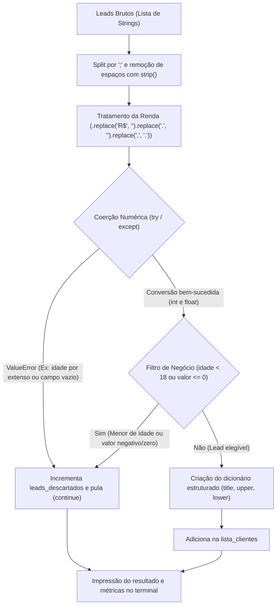
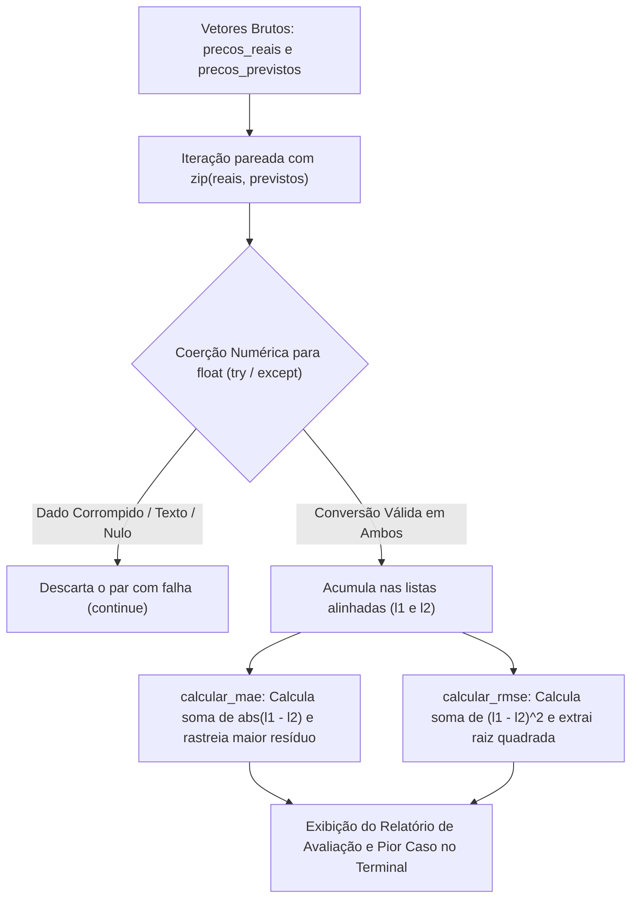

# 🥋 Python Pure Data Challenges: Pre-OOP Foundation Track

[](https://www.python.org/)
[](LICENSE)
[](https://peps.python.org/pep-0008/)

Série prática de desafios em **Python Puro** (*Pure Python* — sem Pandas ou NumPy), focada no desenvolvimento do raciocínio analítico, manipulação nativa de estruturas de dados e tratamento defensivo antes da transição para Programação Orientada a Objetos (POO).

---

## 1. Objetivo

Na preparação para atuar como Engenheiro de Machine Learning e Cientista de Dados, depender exclusivamente de bibliotecas de alto nível como Pandas e Scikit-Learn sem dominar os fundamentos da linguagem cria lacunas severas de lógica, controle de exceções, compreensão da complexidade algorítmica ($O(1)$ vs $O(N)$) e intuição matemática sobre métricas de avaliação.

Este repositório documenta a resolução prática de problemas reais de engenharia e análise de dados utilizando **estritamente os recursos nativos da biblioteca padrão do Python**:

- **Desafio 01 (Sanitizador de Leads de Fintech):** Tratamento defensivo de dados cadastrais textuais despadronizados vindos de formulários web, com coerção segura de tipos (`try...except ValueError`), filtros de elegibilidade e estruturação em dicionários.
- **Desafio 02 (Reconciliação Financeira & Anti-Fraude):** Deduplicação de transações em tempo constante ($O(1)$) através de chaves compostas em tuplas imutáveis e `set`, monitoramento em tempo real de transações noturnas de alto risco e consolidação de faturamento regional com acumuladores nativos em dicionários.
- **Desafio 03 (Mini-Motor de Métricas de Machine Learning):** Alinhamento e higienização vetorial de predições corrompidas com `zip`, seguido do cálculo manual das principais métricas de regressão — **MAE** (Mean Absolute Error) e **RMSE** (Root Mean Squared Error) — além da identificação do pior caso residual sem auxílio de bibliotecas externas.

---

## 2. Demonstração

### Pipeline Nível 1: Sanitizador de Leads (`desafio_01.py`)



#### Saída no Terminal (`desafio_01.py`):
```text
[{'id': 101, 'nome': 'Ana Silva', 'idade': 29, 'valor': 4500.0, 'estado': 'SP', 'situacao': 'aprovado'}, {'id': 104, 'nome': 'Daniel Alves', 'idade': 41, 'valor': 12000.0, 'estado': 'SP', 'situacao': 'aprovado'}, {'id': 108, 'nome': 'Roberto Carlos', 'idade': 65, 'valor': 25000.0, 'estado': 'SP', 'situacao': 'aprovado'}]
Quantidades de leads recebidos: 8
Quantidade de leads aprovados: 3
Quantidade de leads descartados 5
```

---

### Pipeline Nível 2: Reconciliação & Anti-Fraude (`desafio_02.py`)


#### Saída no Terminal (`desafio_02.py`):
```text
Transaçoes processadas: 6 | Transaçoes deduplicadas: 2
Lista de alertas de fraudes noturnos:
 [('Ryan', 12500.0, 'Goiânia'), ('Beatriz', 15000.0, 'Goiânia')]
Faturamento total consolidado por cidade:
{'Goiânia': 27950.0, 'São Paulo': 300.0, 'Brasília': 8000.0, 'Anápolis': 22000.0}
```

---

### Pipeline Nível 3: Mini-Motor de Métricas de ML (`desafio_03.py`)



#### Saída no Terminal (`desafio_03.py`):
```text
LISTAS LIMPAS:
[45000.0, 72000.0, 110000.0, 65000.0]
[43500.0, 75000.0, 102000.0, 64500.0]
Erro médio absoluto: R$ 3250.00
RMSE R$ 4344.54
Caso com maior erro individual: 
Valor Real: 110000.0
Vaslor Previsto: 102000.0
Diferença: 8000.0
```

---

## 3. Tecnologias Utilizadas

- **Linguagem:** [Python 3.12](https://www.python.org/)
- **Estruturas de Dados Nativas & Complexidade:**
  - `zip()`: Pareamento simultâneo e sincronizado de vetores em memória sem indexação manual.
  - `set`: Busca e inserção de chaves em tempo constante médio ($O(1)$) via hashing para deduplicação.
  - `tuple`: Estrutura imutável e hashable utilizada como chave composta para unicidade `(cliente, valor, hora)`.
  - `dict`: Mapeamento estruturado de entidades e acumulador de agregação por cidade.
  - `list`: Coleções sequenciais ordenadas de registros e valores preditivos.
- **Fundamentos Matemáticos de Machine Learning:**
  - **Função de Perda L1 / MAE:** $\text{MAE} = \frac{1}{n} \sum_{i=1}^{n} |y_i - \hat{y}_i|$
  - **Função de Perda L2 / RMSE:** $\text{RMSE} = \sqrt{\frac{1}{n} \sum_{i=1}^{n} (y_i - \hat{y}_i)^2}$
  - Tratamento de resíduos e sensibilidade a outliers em modelos preditivos.
- **Tratamento de Dados e Paradigma Procedimental:**
  - Encapsulamento de regras em funções reutilizáveis (`alinhar_e_limpar_predicoes`, `calcular_mae`, `calcular_rmse`).
  - Coerções primitivas seguras e blindagem com `try...except`.
- **Versionamento:** [Git](https://git-scm.com/) e [GitHub](https://github.com/).

---

## 4. Estrutura do Projeto

```text
python-pure-data-challenges/
├── desafios/
│   ├── desafio_01.py        # Desafio 01: Sanitizador de Leads de Fintech
│   ├── desafio_02.py        # Desafio 02: Reconciliação Financeira & Anti-Fraude Noturno
│   └── desafio_03.py        # Desafio 03: Mini-Motor de Métricas de Machine Learning (MAE e RMSE)
├── .gitignore               # Configuração para ignorar arquivos temporários e caches
├── LICENSE                  # Licença MIT oficial do projeto
├── README.md                # Documentação técnica completa do repositório
└── ROADMAP.md               # Guia com especificações e contexto dos próximos desafios
```

---

## 5. Como Executar

### Pré-requisitos
- Ter o **Python 3.10 ou superior** instalado na máquina.
- Git instalado (opcional, para clonar).

### Passo a Passo

1. **Clonar o Repositório:**
   ```bash
   git clone https://github.com/ryanaurelio2005/python-pure-data-challenges.git
   cd python-pure-data-challenges
   ```

2. **Executar o Desafio 01 (Sanitizador de Leads):**
   ```bash
   python .\desafios\desafio_01.py
   ```

3. **Executar o Desafio 02 (Reconciliação Financeira):**
   ```bash
   python .\desafios\desafio_02.py
   ```

4. **Executar o Desafio 03 (Métricas de Machine Learning):**
   ```bash
   python .\desafios\desafio_03.py
   ```

*Nota: Não é necessária a instalação de nenhuma biblioteca externa (`pip`), pois todo o projeto foi construído utilizando apenas a biblioteca padrão do Python.*

---

## 6. Dataset

### Desafio 01: Lote de Leads Brutos (Strings)

```python
leads_brutos = [
    "  101 ; ANA SILVA ; 29 ; R$ 4.500,00 ; SP ; aprovado ",
    "102;CARLOS SOUZA;trinta e dois;R$ 8.900,50;RJ;aprovado",
    " 103 ; beatriz lima ; 24 ; ; MG ; reprovado ",
    "104; DANIEL ALVES ; 41 ; R$ 12.000,00 ; sp ; APROVADO",
    "105;EDUARDO RAMOS;17;R$ 1.500,00;BA;reprovado",
    " ; Marcos Castro ; 35 ; R$ 3.200,00 ; GO ; pendente ",
    "107; Fernanda Torres ; 52 ; R$ -500,00 ; PR ; aprovado ",
    "108; Roberto Carlos ; 65 ; R$ 25.000,00 ; SP ; aprovado ",
]
```

---

### Desafio 02: Logs de Transações do Gateway (Dicionários)

```python
logs_transacoes = [
    {"id": "tx1", "cliente": "Ryan", "valor": 12500.0, "hora": 23, "cidade": "Goiânia"},
    {"id": "tx2", "cliente": "Lucas", "valor": 300.0, "hora": 14, "cidade": "São Paulo"},
    {"id": "tx3", "cliente": "Ryan", "valor": 12500.0, "hora": 23, "cidade": "Goiânia"},  # Duplicada de tx1
    {"id": "tx4", "cliente": "Carla", "valor": 8000.0, "hora": 9, "cidade": "Brasília"},
    {"id": "tx5", "cliente": "Lucas", "valor": 300.0, "hora": 14, "cidade": "São Paulo"},  # Duplicada de tx2
    {"id": "tx6", "cliente": "Beatriz", "valor": 15000.0, "hora": 2, "cidade": "Goiânia"},
    {"id": "tx7", "cliente": "Ryan", "valor": 450.0, "hora": 15, "cidade": "Goiânia"},
    {"id": "tx8", "cliente": "Marcos", "valor": 22000.0, "hora": 21, "cidade": "Anápolis"},
]
```

---

### Desafio 03: Logs de Inferência de Regressão (Pares Real vs Previsto)

```python
precos_reais = [45000.0, 72000.0, "corrompido", 110000.0, 28000.0, 65000.0, ""]
precos_previstos = [43500.0, 75000.0, 80000.0, 102000.0, "erro", 64500.0, 30000.0]
```

| Amostra | Preço Real | Preço Previsto | Status de Higienização | Motivo |
| :---: | :---: | :---: | :---: | :--- |
| 1 | `45000.0` | `43500.0` | Homologado | Ambos válidos (Erro: R$ 1.500,00) |
| 2 | `72000.0` | `75000.0` | Homologado | Ambos válidos (Erro: R$ 3.000,00) |
| 3 | `"corrompido"` | `80000.0` | Descartado | Falha de coerção no valor real |
| 4 | `110000.0` | `102000.0` | Homologado | Ambos válidos (Pior Caso: R$ 8.000,00) |
| 5 | `28000.0` | `"erro"` | Descartado | Falha de coerção na inferência do modelo |
| 6 | `65000.0` | `64500.0` | Homologado | Ambos válidos (Erro: R$ 500,00) |
| 7 | `""` | `30000.0` | Descartado | String vazia no valor real |

---

## 7. Resultados

### Desafio 01 (Sanitização de Leads)
- **Total recebido:** 8 registros.
- **Aprovados:** 3 registros (37,5%) — Ana Silva, Daniel Alves e Roberto Carlos, em conformidade cadastral.
- **Descartados:** 5 registros (62,5%) com inconsistências tratadas defensivamente.

### Desafio 02 (Reconciliação Financeira & Anti-Fraude)
- **Volume total analisado:** 8 transações.
- **Deduplicação Inteligente:** 6 transações únicas mantidas e 2 transações duplicadas descartadas (`tx3` de Ryan e `tx5` de Lucas).
- **Detecção de Fraude Noturna:** 2 transações suspeitas emitiram alerta (Ryan: R$ 12.500,00 às 23h | Beatriz: R$ 15.000,00 às 02h).
- **Faturamento Consolidado:** Goiânia (R$ 27.950,00), Anápolis (R$ 22.000,00), Brasília (R$ 8.000,00) e São Paulo (R$ 300,00).

### Desafio 03 (Mini-Motor de Métricas de Machine Learning)
- **Amostras brutas recebidas:** 7 pares (Real vs Previsto).
- **Pares homologados após higienização vetorial:** 4 pares íntegros (57,1%).
- **MAE (Erro Médio Absoluto):** **R$ 3.250,00**
- **RMSE (Raiz do Erro Quadrático Médio):** **R$ 4.344,54**
- **Pior Caso Residual (Outlier de Predição):**
  - Valor Real: `R$ 110.000,00`
  - Valor Previsto: `R$ 102.000,00`
  - Diferença Absoluta: `R$ 8.000,00`
- **Interpretação Analítica:** A diferença expressiva entre o RMSE (R$ 4.344,54) e o MAE (R$ 3.250,00) evidencia a propriedade do RMSE de penalizar desvios extremos de forma quadrática, métrica essencial para modelagem de risco e precificação de ativos.

---

## 8. Próximas Versões

Roadmap de evolução prática na trilha pré-POO:

- [x] **Desafio 01:** Sanitizador Defensivo de Leads de Fintech (Concluído).
- [x] **Desafio 02:** Reconciliação Financeira com Deduplicação (`set`) e Detecção de Fraude Noturna (Concluído).
- [x] **Desafio 03:** Cálculo manual de Métricas de Avaliação de Machine Learning — MAE e RMSE (Concluído).
- [ ] **Desafio 04:** Ingestão e Auditoria de Logs de Acesso com Detecção de Ataques de Força Bruta.
- [ ] **Transição POO:** Refatoração modular orientada a objetos das soluções após o domínio da base procedimental.

---

## 👨‍💻 Autor

Desenvolvido por **[Ryan Aurélio](https://github.com/ryanaurelio2005)**.  
*Estudante de Ciência de Dados e Inteligência Artificial (PUC Goiás) | Foco em Engenharia de Machine Learning.*
