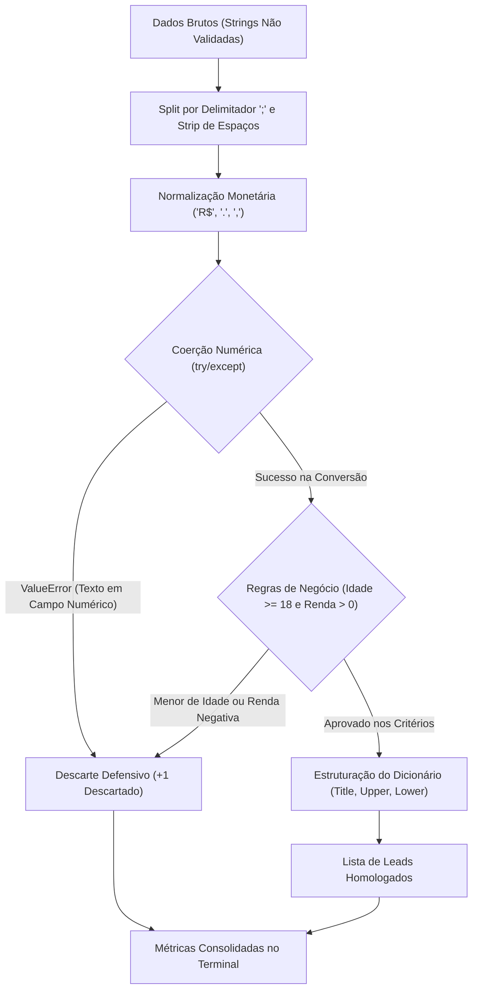

# 🥋 Python Pure Data Challenges: Pre-OOP Foundation Track

[](https://www.python.org/)
[](LICENSE)
[](https://peps.python.org/pep-0008/)

Bateria intensiva de desafios algorítmicos em **Python Puro** (*Pure Python* - sem Pandas ou NumPy), focada no desenvolvimento do raciocínio analítico, manipulação nativa de estruturas de dados e tratamento defensivo antes da transição para Programação Orientada a Objetos (POO).

---

## 1. Objetivo

Na transição para Engenharia de Machine Learning e Ciência de Dados, depender exclusivamente de bibliotecas prontas como Pandas sem dominar os fundamentos da linguagem cria lacunas severas de performance e controle de dados. 

Este projeto tem como meta resolver problemas reais de mercado utilizando **estritamente a biblioteca padrão do Python**, forçando o entendimento de:
- **Sanitização Defensiva de Strings:** Parsing manual de registros com delimitadores despadronizados e caracteres de moeda.
- **Coerção de Tipos e Tratamento de Exceções:** Uso de `try...except ValueError` para blindar a esteira contra dados corrompidos.
- **Complexidade de Estruturas Nativas:** Seleção estratégica entre `dict` (acesso por chave em tempo constante), `set` (operações de unicidade em $O(1)$) e `tuple` (registros imutáveis).
- **Consolidação Pré-POO:** Dominar o fluxo procedimental e funcional de ponta a ponta antes de estruturar arquiteturas orientadas a objetos.

---

## 2. Demonstração

### Arquitetura do Fluxo de Dados (Pipeline Nível 1)



### Saída da Execução no Terminal (`desafio_01_sanitizacao_leads.py`)

```text
============================================================
      RELATÓRIO DE SANITIZAÇÃO DE LEADS (FINTECH)
============================================================

[LEADS VÁLIDOS HOMOLOGADOS]:
  • ID 101 | Ana Silva        | Idade: 29 | Renda: R$   4500.00 | UF: SP | Status: aprovado
  • ID 104 | Daniel Alves     | Idade: 41 | Renda: R$  12000.00 | UF: SP | Status: aprovado
  • ID 108 | Roberto Carlos   | Idade: 65 | Renda: R$  25000.00 | UF: SP | Status: aprovado

------------------------------------------------------------
Total de leads brutos recebidos : 8
Total de leads aprovados        : 3 (37.5%)
Total de leads descartados      : 5 (62.5%)
============================================================
```

---

## 3. Tecnologias Utilizadas

- **Linguagem:** [Python 3.12](https://www.python.org/)
- **Estruturas de Dados Nativas:**
  - `list`: Acumulação dinâmica e iteração ordenada de registros.
  - `dict`: Mapeamento estruturado de campos de entidades sanitizadas.
  - `set`: Unicidade e deduplicação de chaves em alta performance ($O(1)$).
  - `tuple`: Registros imutáveis de transações críticas.
- **Tratamento de Strings e Exceções:**
  - Métodos `split()`, `strip()`, `replace()`, `title()`, `upper()`, `lower()`.
  - Tratamento defensivo com bloco `try...except ValueError`.
- **Versionamento:** [Git](https://git-scm.com/) e [GitHub](https://github.com/).

---

## 4. Estrutura do Projeto

```bash
python-pure-data-challenges/
├── desafios/
│   ├── desafio_01_sanitizacao_leads.py      # Nível 1: Sanitizador de Leads de Fintech (Concluído)
│   ├── desafio_02_reconciliacao_fraude.py   # Nível 2: Reconciliação Financeira & Anti-Fraude Noturno
│   ├── desafio_03_metricas_ml.py            # Nível 3: Mini-Motor de Métricas de ML (MAE e RMSE na mão)
│   └── desafio_04_auditoria_logs.py         # Nível 4: Ingestão de Logs e Detecção de Força Bruta
├── ROADMAP.md                               # Guia completo e especificações dos 4 desafios
├── .gitignore                               # Exclusão de caches de bytecode e arquivos de IDE
└── README.md                                # Documentação técnica obrigatória do repositório
```

---

## 5. Como Executar

### Pré-requisitos
- [Python 3.10+](https://www.python.org/) instalado na máquina.
- Git instalado.

### Passo a Passo

1. **Clonar o Repositório:**
   ```bash
   git clone https://github.com/ryanaurelio2005/python-pure-data-challenges.git
   cd python-pure-data-challenges
   ```

2. **Executar o Desafio 01 (Sanitizador de Leads):**
   ```bash
   python .\desafios\desafio_01_sanitizacao_leads.py
   ```

3. **Acompanhar os Próximos Desafios:**
   Os arquivos de template e contexto detalhados para os níveis 2, 3 e 4 estão disponíveis em [`ROADMAP.md`](ROADMAP.md).

---

## 6. Dataset

O Desafio 01 utiliza um lote de leads cadastrais brutos simulando entradas de formulários web de uma fintech sem validação de front-end:

### Dicionário de Campos Brutos (Separados por `;`)

| Posição | Campo Original | Regra de Sanitização / Validação | Saída Esperada |
| :---: | :--- | :--- | :--- |
| `0` | `id` | Conversão para `int`. Descarte se vazio ou inválido. | `101` |
| `1` | `nome` | Limpeza de espaços nas bordas e formatação Title Case. | `"Ana Silva"` |
| `2` | `idade` | Conversão para `int`. Elegibilidade estrita: $\ge 18$ anos. | `29` |
| `3` | `renda` | Remoção de `"R$"`, pontuação brasileira e coerção para `float` ($> 0$). | `4500.00` |
| `4` | `estado` | Normalização para sigla em maiúsculas (`UF`). | `"SP"` |
| `5` | `status` | Padronização em caixa baixa (`aprovado`, `reprovado`, `pendente`). | `"aprovado"` |

---

## 7. Resultados

A execução do pipeline defensivo sobre a amostra inicial de 8 leads retornou os seguintes resultados:

- **Elegibilidade Homologada:** **3 leads aprovados (37.5%)** atendendo simultaneamente aos critérios de maioridade, id íntegro e renda positiva declarada (Ana Silva, Daniel Alves e Roberto Carlos).
- **Descarte Defensivo:** **5 leads descartados (62.5%)** por inconsistências severas:
  - Idade em formato de texto por extenso (`"trinta e dois"`).
  - Campo de renda nulo/vazio.
  - Lead menor de idade (`17 anos`).
  - ID cadastral ausente/em branco.
  - Valor monetário negativo (`R$ -500,00`).

---

## 8. Próximas Versões

Roadmap de conclusão da trilha pré-POO:

- [x] **Nível 1:** Sanitizador Defensivo de Leads de Fintech (Concluído).
- [ ] **Nível 2:** Reconciliação Financeira com Deduplicação via `set` e Detecção de Fraude Noturna.
- [ ] **Nível 3:** Implementação manual de métricas de Machine Learning (MAE e RMSE sem bibliotecas externas).
- [ ] **Nível 4:** Parser de Stream de Logs com auditoria de requisições e detecção de ataques de Força Bruta.
- [ ] **Módulo POO:** Refatoração da trilha convertendo os pipelines funcionais em Classes encapsuladas de Engenharia de Dados (`LeadPipeline`, `LogAuditor`, `RegressionMetrics`).

---

## 👨‍💻 Autor

Desenvolvido por **[Ryan Aurélio](https://github.com/ryanaurelio2005)**.  
*Estudante de Ciência de Dados e Inteligência Artificial | Foco em Engenharia de Machine Learning.*
